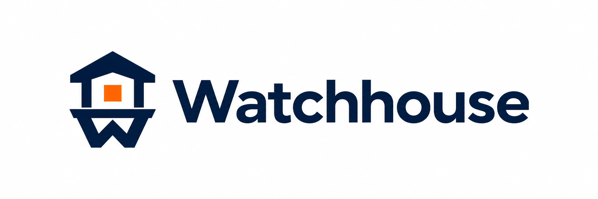

# Watchhouse



**An agent-operated maintenance, incident response, and SRE team.**

Watchhouse turns operational signals into coordinated investigations, evidence-backed decisions, verified fixes, and lasting improvements.

Connect an observability tool such as Sentry or Datadog. Watchhouse assesses what happened and whether action is needed. When a response is warranted, it assigns agents to investigate, challenge findings, mitigate within authorized limits, implement repairs, test, review, and submit changes. Eligible changes can merge automatically under configured policy.

The team keeps the records a real incident organization needs: incident details, investigation logs, escalation and handoff records, change plans, recovery assessments, postmortems, corrective actions, and runbooks.

**Status: bounded M0/M1/M2 mechanisms and M3 source/incident/qualification slices are implemented.** The Rust core owns durable fake execution, independent review, trusted policy, escalation delivery and incident records. Slack and Sentry adapters are fixture-verified; live activation needs explicit mappings, credentials, destinations and trusted ingress. Real harnesses, production mutation and merge automation remain ahead.

## Development validation bundles

Successful CI runs provide `watchhouse-test-<OS>-<architecture>` artifacts containing the native coordinator, embedded web UI, synthetic demo database and formal reports. Local acceptance testing is deferred until the [completion gates](implementation/COMPLETION.md) are met. [TESTING.md](TESTING.md) retains the development-only bundle instructions. These are native debug test builds, not a production release. No Rust, Node or model credential is required to run the bundle.

## Run the local slice

Prerequisites: Rust via rustup (the repository pins 1.90.0), Node.js 22+, and npm. No model account or subscription is needed.

```sh
npm ci --prefix web
npm run build --prefix web
cargo run --locked -- serve
```

Open `http://127.0.0.1:8787` and enter the operator token printed in your terminal. Create a case; the coordinator processes its fake assignment even if you close the browser. Reopen the case to inspect the persisted result and timeline. Investigator results are explicitly synthetic. Add operator-reported evidence, then record a scoped expected/transient/insufficient-evidence disposition with uncertainty, an owner, and a review deadline. Deadline or qualifying recurrence reopens review without implying recovery or repair.

CLI uses the same services and database (default `.watchhouse/watchhouse.db`):

```sh
cargo run --locked -- case create --title "Checkout timeout" --key intake-001
cargo run --locked -- worker --once
cargo run --locked -- case list
cargo run --locked -- case show CASE_ID
```

The key makes command retries safe. `worker --once` is useful without `serve`; `serve` already runs the worker. Use `--db PATH` to select another database, `migrate` to validate/apply migrations, and `serve --port PORT` for another loopback port. Set `WATCHHOUSE_TOKEN` (at least 32 bytes) for a stable local operator token; otherwise each server start generates one. Local CLI access relies on operating-system access to the database.

```sh
cargo fmt --all -- --check
cargo clippy --locked --all-targets -- -D warnings
cargo test --locked
cargo build --locked
cd web
npx playwright install chromium
npm test
```

Browser tests use only a temporary local database and fake execution. Standard checks never invoke a live harness or production system. Linux was validated locally; CI also configures Rust checks on macOS and Windows. The fake-team slice now includes directed messages, stalled-worker supervision, checkpoints, acknowledged handoff, and a local escalation inbox. Independent fake challenges and version-bound assessment validation/closure are available through the [review contract](contracts/v1/challenges/README.md). Configured Slack escalation is implemented; see the [notification contract](contracts/v1/notifications/README.md). The [Sentry/incident contract](contracts/v1/sentry/README.md) covers the first M3 slice. No live integration has been verified. See [current status](implementation/STATUS.md) for evidence and the exact next task.

## Qualification commands

After investigation completes, use the web forms or submit the same versioned JSON commands through CLI:

```sh
cargo run --locked -- case record-evidence CASE_ID --file evidence.json
cargo run --locked -- case record-disposition CASE_ID --file disposition.json
cargo run --locked -- case reconsider CASE_ID --file reconsideration.json
cargo run --locked -- tick
```

Start from the [qualification command examples](contracts/v1/README.md). Replace expected versions, evidence digests, and the current disposition ID with values returned by your case snapshot. Timers are explicit per decision and bounded by the case’s pinned policy. `serve`/`worker` process persisted deadlines automatically; `tick` processes them without an executor. Expected/transient decisions require operator-reported supporting evidence; synthetic results alone do not establish those facts. The UI keeps source attribution and uncertainty visible.

## Run the core without a web server

The native `watchhouse` binary owns coordination. CLI workers can drive the fake team against the same durable database:

```sh
cargo run --locked -- case create --title "Investigate timeout" --key team-001
cargo run --locked -- worker --block --once
cargo run --locked -- case list
cargo run --locked -- case show CASE_ID
cargo run --locked -- team offer-handoff CASE_ID --file handoff.json
cargo run --locked -- worker --identity fake-specialist --once
cargo run --locked -- team inbox
```

Use the [handoff command example](contracts/v1/team/handoff.json), replacing its block ID and expected version from the case snapshot. The first worker stores a blocker/checkpoint; the successor discovers and accepts the durable handoff before ownership changes. A late old result is retained as unaccepted evidence and cannot complete the task.

`worker --stall` simulates a live fake process with heartbeats but no useful progress. `serve --manual-workers` runs the scheduler and operating interface while separate CLI workers dispatch. `tick` supervises due work without an executor. Trusted versioned fake deadlines and budgets are configured through the [operator policy contract](policy/README.md); handoff cannot reset them. The [Slack escalation adapter](contracts/v1/notifications/README.md) supports configured human fallback, delivery tracking and explicit resolution; no live destination is configured or verified. Real harnesses, installers and OS service registration remain ahead.

## A typical response

1. Sentry reports errors after a release.
2. Triage correlates the signal with existing cases and checks the affected service, release, and users.
3. Expected behavior is catalogued. Uncertain or apparently transient issues receive a monitoring decision with explicit reopening conditions.
4. For an actionable incident, a commander coordinates investigators and assigns work.
5. Investigators exchange evidence and challenge hypotheses. A verifier reproduces the failure.
6. An engineer prepares a fix. Independent verification and review assess the exact candidate.
7. The release workflow opens a PR and may merge it if all configured gates and repository requirements pass.
8. Deployment and service behavior are checked separately. The incident receives a recovery assessment, a postmortem when required, and tracked follow-up actions.
9. Accepted lessons inform future responses.

If an agent is stuck, Watchhouse records the blocker, notifies another responder, transfers work safely, or escalates to a person. The task always has an accountable owner.

## The brain lives here

Watchhouse owns the incident process, shared state, assignments, communication, evidence, policy, and learning.

Claude Code, Codex, Hermes, pi, and other harnesses are replaceable execution backends. They provide agent execution and model access using their supported authentication and configuration. Watchhouse does not need to copy their subscription credentials.

A role can use a different harness or model without changing the incident workflow. Runtime capabilities and subscription availability must be checked; support is not assumed from a product name.

## A team you can see

The planned web interface shows:

- Service health, incoming cases, active incidents, and priorities.
- Agent assignments, conversations, challenges, decisions, and handoffs.
- Reproductions, diffs, checks, reviews, PRs, deployment, and recovery evidence.
- Blockers, escalation deadlines, and requests for human judgment.
- Postmortems, corrective actions, runbooks, and accepted lessons.
- Policies, budgets, runtime health, and pause controls.

Every status should explain why it is true, who owns the next action, and what happens next.

## Built on explicit boundaries

- Observability providers are integrations; their grouping is not the factory's entire data model.
- Classification and authorization are separate decisions.
- Incident recovery, permanent repair, deployment, and follow-up have separate lifecycles.
- Agents collaborate through durable shared records, with independent challenge and verification.
- Agents cannot approve their own changes or expand their own authority.
- Timers, notifications, leases, budgets, and escalation work without an available model.
- Formal operational artifacts are authoritative. An editorial summary is optional.

## Relationship to Hallmark

[Hallmark](https://github.com/tiagocolombo/hallmark) is a related local development and review system. Watchhouse is a separate product.

Hallmark may serve as an optional repair backend. Its lessons format is a candidate for knowledge compatibility. Watchhouse must remain usable without Hallmark installed.

## Continue the work

Start with the [implementation guide](implementation/README.md), then the [current status](implementation/STATUS.md) and [roadmap](implementation/11-roadmap.md).

The [agent instructions](AGENTS.md) explain how to continue across sessions. The implementation documents preserve requirements, proposed architecture, interfaces, acceptance scenarios, and unresolved decisions without relying on chat history.

[Icon and logo assets](assets/README.md).

## Source intake and incident records

Use the [Sentry configuration and incident contract](contracts/v1/sentry/README.md). Signed issue notifications enter a durable queue; independent source processing enriches and reconciles observations before explicit operator declaration. `source-status` shows incomplete coverage and missing enrichment; `source-sync` advances one bounded page/item without models. Incident JSON and Markdown preserve roles, impact uncertainty, evidence, update duties and separate unknown recovery.

## Operate an incident

[Incident operations and artifacts](contracts/v1/incidents/README.md) add versioned commander updates, accepted role handoffs, hypothesis/experiment records and independent review of unsent communication drafts. `case operate-incident` and `case record-incident-artifact` share CLI/API/web contracts. Evidence and review deadlines escalate without models. `case investigation-markdown` renders retained findings and failed attempts.

The source pump also refreshes known issues beyond discovery windows. Read health is separate from source fact history: unchanged polling refreshes freshness without spamming case events, while fenced overlapping results cannot overwrite newer observations. Source status and communication approval never assert service recovery or grant production authority.

## Qualify and correlate source cases

The [case correlation contract](contracts/v1/correlations/README.md) adds bounded diagnostic context, scoped comparison suggestions and evidence-backed related/duplicate links. Links are reversible and preserve every case and duty. Use `case correlate CASE_ID --file FILE` and `case qualification-markdown CASE_ID`, or inspect the web correlation panel. Synthetic checkout-contract fixtures prove scoped expected-behavior review; actual service history and the [prepared live activation drill](implementation/16-m3-activation-drill.md) remain unverified.

## Prepare repair inputs

The first [M4 preparation slice](contracts/v1/repair/README.md) freezes an explicitly configured local base, inspects pinned runtime version/help metadata and records evidence-backed blocked repair requests with owned escalation. Real execution remains denied until worker containment, cancellation and scoped authority are demonstrated. Use the [example generator](examples/README.md) to inspect current incident/investigation reports with synthetic data.

## Qualify a worker boundary

[Controlled worker qualification](contracts/v1/worker-qualification/README.md) pins trusted tools and records measured probe outcomes with evidence, owner, expiry, interruption and quarantine handling. The fixed Linux payload tests selected filesystem/network/resource/descendant properties; it runs no candidate or model. The local host rejected namespace setup, and all real harness execution remains denied. Operators can inspect status in the web interface and reconcile quarantined resources with reported evidence.

## Exercise adapter recovery

The [synthetic adapter lifecycle](contracts/v1/adapter-trials/README.md) exercises durable start/events/result/cancel/reconciliation against frozen repair requests. Use `case adapter-trial`, inspect status/events, and view the web panel. Lost acknowledgments remain unknown until reconciled; deadline supervision works offline. All outcomes are explicitly synthetic and grant no real harness or repair authority.

## Assess recovery and follow through

[Recovery v1](contracts/v1/recovery/README.md) supports prospective criteria, reported observation windows, independent review and response resolution. Low traffic/coverage stays inconclusive. Corrective actions keep their owners, independent verification and overdue escalation after response resolution. Mitigation is a blocked proposal; deployment is an explicit report. `case recovery` and `case recovery-markdown` share the web/API records. The [example generator](examples/README.md) includes a complete synthetic recovery/follow-up scenario for local testing.

## Review and reuse operational learning

[Learning v1](contracts/v1/learning/README.md) adds postmortem impact/cause/action records and independently reviewed scoped lessons. Unknown causes remain explicit. Pending/imported proposals cannot replace accepted knowledge. Exact-scope retrieval excludes expired/stale/retired entries, and new fake worker briefings freeze accepted versions. Use `case learning`, `case learning-markdown`, and `knowledge`; the gallery exercises the complete operator-driven incident/recovery/learning flow without models.

## Native container checks and candidate review

[Native repair v1](contracts/v1/native-repair/README.md) adds an explicitly configured Linux container worker, measured boundary qualification, frozen operator-provided text candidates, base/candidate regression and independent attributed review. Native authority requires current physical proof; synthetic/controller observations cannot grant it. The CLI/API/web retain unknown effects, quarantine, bounded cleanup and stale review. Container tests and model work have separate admission. The bounded model-client adapter below is implemented; model-result adoption and GitHub delivery remain separate M4 work. Local acceptance testing stays deferred under the completion ledger.

## Exchange reviewed knowledge with Hallmark

[Hallmark exchange v1](contracts/v1/hallmark/README.md) imports bounded JSON exports as immutable unreviewed source records and preserves exact bytes for re-export. Explicitly mapped local proposals still require normal independent evidence/context review. Current accepted Watchhouse knowledge can be exported as proposed Hallmark lessons with source identity and applicability retained. CLI/API/web share the same records; no Hallmark installation or external authority is required.

## Bounded model workers

[Model runtime v1](contracts/v1/model-runtime/README.md) adds immutable OS-installed client profiles, explicitly queued engineer/reviewer text roles, native cgroup resource/cancellation qualification, sealed result journals and no-replay recovery for uncertain launches. `model-policy`, `model-worker`, and `case request-model`/`model-job`/`manage-model` share durable state with authenticated API and web inspection. The server does not start paid work automatically. Synthetic transport qualification does not verify live authentication, account access or a real model; those remain explicit activation gates. Candidate programs run only in the separate credential-free container worker.


## Reviewed PR delivery

[Delivery v1](contracts/v1/delivery/README.md) prepares exact Git artifacts and queues separately authorized publication. The explicit publisher worker uses its own immutable OS policy and credential reference, retains one branch/PR per repair, and reconciles lost acknowledgments without repeating uncertain writes. CLI, authenticated API and the web interface expose owned status and quarantine. Automatic merge, deployment and recovery remain separate gates. Synthetic tests cover the controller; live publication still requires a dedicated authorized test repository and publisher credential.

## Controlled operations and known errors

[Operations v1](contracts/v1/operations/README.md) adds OS-installed runbook/target policy, independent proposal review, separately invoked no-replay dispatch, bounded read-only reconciliation, authenticated deployment/telemetry collection and versioned owned problem/known-error links. Retained telemetry can enter the existing prospective recovery review; action or deployment success never implies recovery. Fixtures verify controller behavior. Physical gateway target/stop/rollback and live integration activation require explicitly authorized configuration and independent evidence.

## Eligible automatic merging

[Merging v1](contracts/v1/merging/README.md) adds separately installed merge authority and a deterministic controller after native publication. It checks exact candidate/base/head/tree, independently verified review, protected app-pinned CI and repository approvals before an exact-head merge-commit request. Sensitive paths, stale or unknown facts and policy pause deny admission. Reserved uncertainty is reconciled by reads without replay. Fixtures exercise eligibility, denial and crash recovery; no dedicated live merge repository or credentials are configured.

## Datadog monitor intake

[Datadog v1](contracts/v1/datadog/README.md) adds independently mapped current-monitor polling and fair bounded reconciliation. Native read transport, configuration fencing, read health, common incident timers and web coverage are implemented. Monitor `OK` never means recovered; traffic, historical transitions, release and deployment remain unknown. Fixtures validate the controller; actual account/history activation requires explicit mappings and scoped credentials.

## Independent text harness profiles

[Claude Code text roles](contracts/v1/claude-runtime/README.md) add a second fixed adapter with its own profile, credential reference and native admission. Profiles are active independently by adapter/name; a Codex-authored candidate can receive fresh independent review through another configured harness without transferring its private transcript. Actual local CLI compatibility was tested against a synthetic endpoint. Live account/model access and native worker platform gates remain separate.
